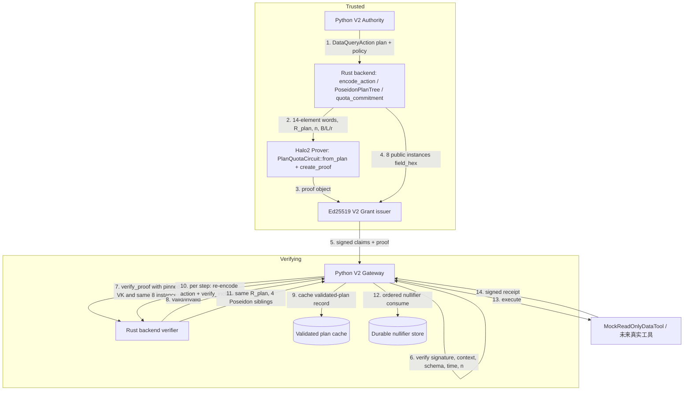

# Step 3.2C-0 — Halo2 与 Python Gateway 集成契约（设计，不实现）

状态：接口与信任模型设计稿。本文只回答 Step 3.2C 开始前必须定清的契约问题；**不实现代码、不生成真实 proof、不启动性能实验、不宣称新颖性，也不把设计完成描述成代码已实现**。

基线：`kaikai-cao/agent-exec-binding-mvp` @ `48169bc7d0d6dbaf231fb0d2944a8d85035c9e9c`（Step 3.2B 已封存并在独立临时目录全量克隆复现：`cargo fmt --check` 通过，`cargo test --locked` 53 passed / 0 failed）。本轮仅新增本文件。

标记约定：

- `[FACT]`：可从指定源码位置直接核对的既有行为；
- `[REC]`：本设计提出的推荐契约，尚未实现；
- `[OPEN]`：必须由人类决策者定夺、本轮不擅自修改冻结规格的未决问题。

---

## 0. 结论摘要

Step 3.2C 不能只是给现有 Ed25519 Grant 增加一个 proof 字段。至少存在四个阻断项：

1. V1 Python 授权/执行使用 SHA-256 Merkle 根；V2 电路使用固定 16 叶 Poseidon 根，二者不能互认。`[FACT: data_access.py:300,476；plan_batch.py:50-61,101-186；zk-v2-host/src/lib.rs:254-338]`
2. Python `DataQueryAction` 接受的字符串资源/字段/任意短过滤值比 Rust 编码器的固定枚举更宽；Python 授权通过不代表 V2 电路可编码。`[FACT: data_access.py:82-117；zk-v2-host/src/lib.rs:102-159,166-237]`
3. 现有 `H_schema` 是 v1 schema digest，而 v0.2 规格要求 v2 定义独立 schema digest；两者口径冲突，需决策。`[FACT: data_access.py:49-65；docs/agent-exec-binding-mvp-step3-relation-spec-v0.2.md:147-148]`
4. `C_quota` 只承诺 `(B,L,r)`，不证明其与 SHA-256 `policy_commitment` 或私有 allowlist 的关系。`[FACT: data_access.py:239-242；docs/agent-exec-binding-mvp-step3-relation-spec-v0.2.md:58-75]`

因此采用版本边界：V1 保持冻结；另建 V2 独立授权路径，Rust 作为唯一的 Poseidon / 编码 / proof 后端。

---

## 1. 源码事实清单

| ID | 事实 | 代码位置 |
| --- | --- | --- |
| F1 | `data_access.py` 自述为 Ed25519 基线，明确不是 ZK 实现，并复用 SHA-256 Merkle。 | `data_access.py:1-6` |
| F2 | V1 授权方构造 `plan_batch.MerkleTree`，把 `tree.root` 写入 `plan_root` claim。 | `data_access.py:300,322` |
| F3 | V1 Gateway 用 `MerkleTree.verify(action, inclusion_proof, plan_root)` 逐步验包含。 | `data_access.py:474-477` |
| F4 | V1 Merkle 叶/父节点是 `SHA-256(0x00‖u32(index)‖canonical_json)` 与 `SHA-256(0x01‖left‖right)`，奇数宽度 duplicate-last。 | `plan_batch.py:50-61,101-126` |
| F5 | V2 Host 的叶/父/padding 是 Poseidon：`Poseidon^14(M_i)`、`Poseidon^3(D_NODE,l,r)`、`Poseidon^2(D_PAD,i)`；固定 16 叶四层。 | `zk-v2-host/src/lib.rs:69-71,239-252,254-295` |
| F6 | V2 `verify_inclusion` 用 Poseidon 根、`action_count`、4 个 sibling，并检查 `proof.index == action.step`。 | `zk-v2-host/src/lib.rs:314-338` |
| F7 | Python 动作仅校验资源/字段名为正则、filters 至少 1 个且字段不重复、selected_fields 至少 1 个且不重复、值是非空字符串 ≤128 字符。 | `data_access.py:82-117` |
| F8 | Rust `encode_action` 固定资源 2 个、filter field 3 个、selected field 5 个、filter value 9 个；filters 1..2、selected 1..3；拒绝不兼容组合。 | `zk-v2-host/src/lib.rs:102-159,166-237` |
| F9 | Rust 32-byte digest 拆分为两个大端 128-bit limb，不模约减；字段规范序列化为 `hex(to_repr())`。 | `zk-v2-host/src/lib.rs:77-100` |
| F10 | V2 公共输入顺序固定为 `C_quota,R_plan,n,H_ctx_hi,H_ctx_lo,H_schema_hi,H_schema_lo,C_statement`。 | `zk-v2-host/src/lib.rs:407-423`；`docs/agent-exec-binding-mvp-step3-relation-spec-v0.2.md:272-289` |
| F11 | `plan_context_hash` 的 preimage 仅含 `principal,tenant_id,session_id`。 | `plan_batch.py:319-325` |
| F12 | `agent_exec_binding.py` 的另一套 context 含 `task_id`，与 D1 数据访问路径不同。 | `agent_exec_binding.py:99-109,246-275` |
| F13 | 现有 `DATA_QUERY_TOOL_SCHEMA` 的 `version=1`，`DATA_QUERY_SCHEMA_HASH = object_digest(...)`。 | `data_access.py:49-65` |
| F14 | v0.2 规格要求 v2 另建 `DATA_QUERY_TOOL_SCHEMA_V2` / `DATA_QUERY_SCHEMA_HASH_V2`，不得复用 v1 hash。 | `docs/agent-exec-binding-mvp-step3-relation-spec-v0.2.md:147-148` |
| F15 | `PlanQuotaCircuit::from_plan` 已接收动作、B、L、blinding、context digest、schema digest，并返回电路与 8 个 host 计算实例。 | `zk-v2-host/src/plan_quota_circuit.rs:101-146` |
| F16 | `from_plan` 逐槽检查 `step==index` 并调用 Rust `encode_action`；私有 witness 字段不公开。 | `zk-v2-host/src/plan_quota_circuit.rs:50-62,101-121` |
| F17 | 当前 `main.rs` 只打印 demo 实例和 inclusion proof，blinding 是固定 fixture，明确不得用于真实授权。 | `zk-v2-host/src/main.rs:11-17,31-37` |
| F18 | 全仓库检索 `create_proof`/`verify_proof`/`keygen_vk`/`keygen_pk`/`Params::new`/`Blake2b` 均无匹配；真实 proof API 尚未接入。 | 在基线 `48169bc` 全仓 `*.rs/*.py/*.md` grep |
| F19 | `DataAccessAuthorization` 持有 `issuer_policy` 与 salt，注释要求永不发给 agent 或 gateway。 | `data_access.py:221-228` |
| F20 | V1 Gateway 的 nullifier 消费使用进程内 `set` + `Lock`，注释承认真实部署需要共享持久事务状态。 | `data_access.py:435-437,481-490`；`plan_batch.py:444-445` |
| F21 | Halo2 0.4 `create_proof` / `verify_proof` / `keygen_vk` / `keygen_pk` 的签名如下文 E 节所列；`Params::new(k)` 本地生成。 | `halo2_proofs-0.4.0/src/plonk/prover.rs:34-47`、`verifier.rs:67-79`、`keygen.rs:189-198,251-259`、`poly/commitment.rs:35-38` |
| F22 | Pallas Base = `Fp` = Vesta Scalar；因此以 `pallas::Base` 为电路 scalar 时 PLONK 曲线参数应为 `vesta::Affine`。 | `pasta_curves-0.6.0/src/pallas.rs:6-9`、`vesta.rs:6-9`；`halo2_proofs-0.4.0/src/plonk/keygen.rs:193-197` |

---

## 2. 数据流图（推荐，未实现）



`[REC]` Rust 后端是唯一的密码学编码、Poseidon、Merkle 与 proof 实现位置；Python 不复制 Poseidon 或字段序列化逻辑。

---

## A. 协议版本边界

### A.1 `[FACT]` 既有 V1

- `TOOL_ID = "data.query.v1"`，V1 明确是 Ed25519 + SHA-256 基线。`[data_access.py:1-6,37]`
- 授权方使用 `plan_batch.MerkleTree` 生成 `plan_root`。`[data_access.py:300,322]`
- 执行网关使用 `MerkleTree.verify` 验证 SHA-256 inclusion proof。`[data_access.py:474-477]`
- 现有测试覆盖该路径；本轮不改 `data_access.py`、`plan_batch.py` 及其测试。

### A.2 `[REC]` 新增 V2

- 使用独立模块/类，例如 `data_access_v2.py` 与 `DataAccessAuthorityV2` / `DataAccessGatewayV2`，不静默替换 V1。
- V2 的 Grant、`ProofBundle`、逐步 `InclusionProofV2` 必须引用同一个 Poseidon `R_plan`，其唯一合法来源是 Rust `PoseidonPlanTree::root()`。`[zk-v2-host/src/lib.rs:254-295]`
- V2 Grant 标记 `protocol = "data-query-v2-poseidon"`、`grant_version = 2`；V1 的 `grant_version = 1` 继续由 V1 路径处理。`[data_access.py:314,458]`
- V2 不得出现 SHA-256 `plan_root` 字段；若历史上存在同名字段，必须改名或拒绝，避免误用。

### A.3 `[OPEN]`

- V1 与 V2 是否共存于同一 Python 包、是否共享 `AuthorizationError`、是否共享工具执行器，需要后续实现任务决定；本设计只要求行为隔离和数据隔离。

---

## B. 规范动作编码

### B.1 `[FACT]` Python 侧更宽

`DataQueryAction.__post_init__` 接受任意匹配 `^[a-z][a-z0-9_]{0,63}$` 的 resource/filter field/selected field，过滤值可为任意 ≤128 字符字符串，selected/filter 数量下限为 1，但没有 v2 的 2/3 上限。`[data_access.py:43-44,82-117]`  
`DataAccessPolicy` 的 allowlist 是通用字符串集合，与 Rust 固定 ID 表不是同一套对象。`[data_access.py:134-217]`

### B.2 `[FACT]` Rust 侧固定编码

`encode_action` 生成 14 元素消息：`[D_ACTION,2,step,resource_id,filter_count,ff0,fv0,ff1,fv1,field_count,f0,f1,f2,max_rows]`；未使用槽位为 0。`[zk-v2-host/src/lib.rs:166-237]`  
动作叶、padding、父节点与根都由同一 Host primitive 计算。`[zk-v2-host/src/lib.rs:239-295]`

### B.3 `[REC]` Python → Rust 转换表

| Python `DataQueryAction` | Rust 函数 / 常量 | V2 允许值 | 失败处理 |
| --- | --- | --- | --- |
| `resource` | `resource_id()` `lib.rs:102-108` | `sales_records`→1；`support_metrics`→2 | 任何其它字符串拒绝 |
| `filters[i][0]` | `filter_field_id()` `lib.rs:121-128` | `category`→1；`quarter`→2；`region`→3 | 未知字段拒绝 |
| `filters[i][1]` | `filter_value_id()` `lib.rs:130-143` | `category={account,billing,technical}`→{1,2,3}；`quarter={2026-Q3,2026-Q4}`→{4,5}；`region={east,north,south,west}`→{6,7,8,9} | 未知值拒绝 |
| `filters` 数量 | `encode_action()` `lib.rs:176-178` | 1..=2 | 0 或 >2 拒绝 |
| `selected_fields` | `selected_field_id()` `lib.rs:110-119` | `category`→1；`quarter`→2；`region`→3；`revenue_cents`→4；`ticket_count`→5 | 未知字段拒绝 |
| `selected_fields` 数量 | `encode_action()` `lib.rs:179-181` | 1..=3 | 0 或 >3 拒绝 |
| resource ↔ selected | `selected_field_allowed()` `lib.rs:145-151` | resource 1→{2,3,4}；resource 2→{1,2,5} | 不兼容拒绝 |
| resource ↔ filter field | `filter_field_allowed()` `lib.rs:153-159` | resource 1→{2,3}；resource 2→{1,2} | 不兼容拒绝 |
| 去重与排序 | `encode_action()` `lib.rs:183-215` | 按 numeric ID 严格递增；重复拒绝 | Python 侧数组顺序不再作为规范顺序 |
| `step` | `encode_action()` `lib.rs:167-169`；`PoseidonPlanTree::new()` `lib.rs:260-269` | 槽位下标 0..15，活动槽位必须 `step == i` | 跳位/错位拒绝 |
| `max_rows` | `encode_action()` `lib.rs:172-174` | 1..=65535 | 0 或 65536 拒绝 |
| 16 槽 padding | `padding_leaf()` `lib.rs:243-248`；`PoseidonPlanTree::new()` `lib.rs:260-270` | 非活动槽位 14 元素全 0，叶子为 `Poseidon^2(D_PAD,i)` | 不得把 padding 当动作 |

### B.4 `[REC]` 拒绝规则

V2 授权阶段必须调用 Rust `encode_action` / `PoseidonPlanTree::new` / `PlanQuotaCircuit::from_plan` 做一次完整转换；任一步返回 `Err` 或 `Result::Err` 时，直接拒绝该计划，**不得签发 V2 Grant**。Gateway 在执行每步时用同一 Rust 函数重新编码，防止传输层改动动作。`[zk-v2-host/src/plan_quota_circuit.rs:101-121]`

公开工具 schema 的结构兼容性检查只说明动作能被固定编码，不证明私有 allowlist。`[docs/agent-exec-binding-mvp-step3-relation-spec-v0.2.md:313-323]`

---

## C. Digest 与公共输入契约

### C.1 `[FACT]` `H_ctx`

完整 preimage 为 JSON 对象：

```json
{"principal": "<principal>", "tenant_id": "<tenant_id>", "session_id": "<session_id>"}
```

经 `canonical_json`（`sort_keys=True, separators=(",",":"), ensure_ascii=False`, UTF-8）后做 SHA-256，得到 32-byte digest。`[plan_batch.py:32-47,319-325]`  
不得使用 `agent_exec_binding.py` 中含 `task_id` 的 `ExecutionContext` 替换。`[agent_exec_binding.py:99-109,246-275]`

### C.2 `[FACT]/[OPEN]` `H_schema`

现有 `DATA_QUERY_SCHEMA_HASH` 是对 `DATA_QUERY_TOOL_SCHEMA`（`version=1`）的 `object_digest`。`[data_access.py:49-65]`  
但 v0.2 规格明确要求 v2 另建 `DATA_QUERY_TOOL_SCHEMA_V2` 与 `DATA_QUERY_SCHEMA_HASH_V2`，且不得复用 v1 hash。`[docs/agent-exec-binding-mvp-step3-relation-spec-v0.2.md:147-148]`

`[OPEN]` 这是冲突项。两种可选口径：

| 选项 | 含义 | 风险 |
| --- | --- | --- |
| O1：复用 v1 `DATA_QUERY_SCHEMA_HASH` | 按用户初步建议，最小改动 | schema digest 不绑定 v2 固定枚举与 2/3 数量上限；与冻结规格 §4.1 不一致 |
| O2：定义 v2 schema digest | 按规格另建 schema 对象并取其规范 SHA-256 | 需要人类确认 object 内容；仍复用 `object_digest` 机制而非新算法 |

`[REC]` 推荐 O2：复用 `object_digest` / `canonical_json` 机制，但对象版本升级为 v2；在 V2 Grant 中明确写 `tool_schema_digest`。本轮不改规格、不改代码。

### C.3 `[FACT]` 128-bit limb 与字段序列化

`digest_to_limbs()` 将 32-byte digest 的前 16 字节按大端解析为 `hi`，后 16 字节为 `lo`，各自 `<2^128`；不模约减。`[zk-v2-host/src/lib.rs:89-100]`  
字段规范序列化为 `hex::encode(to_repr())`，即 32-byte hex。`[zk-v2-host/src/lib.rs:77-79]`

`[REC]` Python 只传 32-byte hex 字符串；Rust 后端负责解析为非规范表示拒绝的 `Fp`。禁止十进制字符串、禁止把 digest 模约减成单个 field、禁止第二种字段序列化。

### C.4 `[FACT]/[REC]` 八个公共输入

| index | 名称 | 源 | 编码 |
| --- | --- | --- | --- |
| 0 | `C_quota` | `quota_commitment(B,L,r)` `[lib.rs:340-353]` | 32-byte hex |
| 1 | `R_plan` | `PoseidonPlanTree::root()` `[lib.rs:254-295]` | 32-byte hex |
| 2 | `n` | `active` 求和；`PlanQuotaCircuit::from_plan` 同时返回 `[plan_quota_circuit.rs:101-146]` | field hex；另有整数 claim `action_count` |
| 3 | `H_ctx_hi` | `digest_to_limbs(H_ctx)[0]` `[lib.rs:91-100]` | 32-byte hex |
| 4 | `H_ctx_lo` | `digest_to_limbs(H_ctx)[1]` | 32-byte hex |
| 5 | `H_schema_hi` | `digest_to_limbs(H_schema)[0]` | 32-byte hex |
| 6 | `H_schema_lo` | `digest_to_limbs(H_schema)[1]` | 32-byte hex |
| 7 | `C_statement` | `statement_commitment()` `[lib.rs:389-405]` | 32-byte hex |

签名信封必须绑定全部 8 个值。`[docs/agent-exec-binding-mvp-step3-relation-spec-v0.2.md:289,300]`  
Gateway 必须检查 `action_count == public_instances[2] == n == len(encoded_actions)` 且 `1 <= n <= 16`。

---

## D. Ed25519 授权信封

### D.1 `[REC]` V2 Grant schema

签名方式与 V1 一致：Ed25519 对 `canonical_json(claims)` 签名，signature 用 hex 表示。`[data_access.py:328,454]`  
V2 claims 至少包含：

```json
{
  "protocol": "data-query-v2-poseidon",
  "grant_version": 2,
  "policy_id": "<policy_id>",
  "policy_version": 1,
  "policy_commitment": "<sha256-policy-commitment-hex>",
  "principal": "<principal>",
  "tenant_id": "<tenant_id>",
  "session_id": "<session_id>",
  "tool_schema_hash": "<H_schema-hex>",
  "context_hash": "<H_ctx-hex>",
  "plan_root_poseidon": "<R_plan-field-hex>",
  "action_count": 3,
  "plan_nonce": "<hex>",
  "issued_at": 0,
  "expires_at": 0,
  "vk_id": "<pinned-verifying-key-fingerprint>",
  "public_instances": {
    "format": "pallas-base-32-byte-hex-v1",
    "values": [
      {"index": 0, "name": "C_quota", "field_hex": "..."},
      {"index": 1, "name": "R_plan", "field_hex": "..."},
      {"index": 2, "name": "n", "field_hex": "..."},
      {"index": 3, "name": "H_ctx_hi", "field_hex": "..."},
      {"index": 4, "name": "H_ctx_lo", "field_hex": "..."},
      {"index": 5, "name": "H_schema_hi", "field_hex": "..."},
      {"index": 6, "name": "H_schema_lo", "field_hex": "..."},
      {"index": 7, "name": "C_statement", "field_hex": "..."}
    ]
  },
  "proof_digest": "<sha256-of-canonical-proof-bundle-hex>"
}
```

`policy_commitment` 继续是 SHA-256 私有策略承诺，不声称等于 `C_quota`。`[data_access.py:239-242；docs/agent-exec-binding-mvp-step3-relation-spec-v0.2.md:58-75]`

### D.2 `[REC]` proof 是独立传输对象

推荐 `ProofBundle` 独立传输，不把 proof 字节放进签名 claims：

```json
{
  "proof_format": "halo2-0.4.0-pallas-base-v1",
  "proof_hex": "...",
  "vk_id": "<same-as-grant>",
  "circuit_id": "plan-quota-16-leaf-statement-binding-v1",
  "k": 13,
  "public_instances_digest": "<sha256-of-canonical-8-values>"
}
```

`[REC]` `proof_digest = hex(SHA-256(canonical_json(proof_bundle)))`；`public_instances_digest = hex(SHA-256(canonical_json(values)))`。两者都使用 `plan_batch.canonical_json` 的同一规则。`[plan_batch.py:32-47]`

签名信封通过 `proof_digest` 绑定具体 proof。`[REC 理由]` 若只签 public inputs 而不签 proof digest，同一份 proof 在 8 个实例完全相同、但 nonce/有效期不同的 Grant 之间仍可复用；签名 proof digest 可阻断该重放面。该字段不在 v0.2 八个 public instances 中，不改变电路关系。

### D.3 `[FACT]/[REC]` 一致性检查

- V1 Gateway 已检查 principal/tenant/session/schema/有效期/action_count。`[data_access.py:458-475]`
- V2 额外检查：`vk_id` 匹配部署 pin、`proof_digest` 匹配、8 个实例格式与顺序正确、`n == action_count`、`R_plan` 与实例 1 相同、`C_statement` 与实例 7 相同。
- 任何检查失败均在调用工具前拒绝。

---

## E. Prover 与 Verifier 接口

### E.1 `[FACT]` 当前状态

仓库中没有 `create_proof` / `verify_proof` / `keygen_vk` / `keygen_pk` / `Params::new` 调用；只有 MockProver 测试与 demo 输出。`[F18；zk-v2-host/src/main.rs:1-40]`  
`Cargo.toml` 固定 `halo2_proofs = "=0.4.0"`、`halo2_gadgets = "=0.6.0"`、`halo2_poseidon = "=0.2.0"`、`pasta_curves = "=0.6.0"`，不得在本轮改依赖。`[zk-v2-host/Cargo.toml:9-16]`

### E.2 `[FACT]` Halo2 0.4 实际 API

```rust
pub fn keygen_vk<C, ConcreteCircuit>(
    params: &Params<C>,
    circuit: &ConcreteCircuit,
) -> Result<VerifyingKey<C>, Error>
where
    C: CurveAffine,
    C::Scalar: FromUniformBytes<64>,
    ConcreteCircuit: Circuit<C::Scalar>;
```
`[halo2_proofs-0.4.0/src/plonk/keygen.rs:189-198]`

```rust
pub fn keygen_pk<C, ConcreteCircuit>(
    params: &Params<C>,
    vk: VerifyingKey<C>,
    circuit: &ConcreteCircuit,
) -> Result<ProvingKey<C>, Error>
```
`[keygen.rs:251-259]`

```rust
pub fn create_proof<C, E, R, T, ConcreteCircuit>(
    params: &Params<C>,
    pk: &ProvingKey<C>,
    circuits: &[ConcreteCircuit],
    instances: &[&[&[C::Scalar]]],
    rng: R,
    transcript: &mut T,
) -> Result<(), Error>
```
`[prover.rs:34-47]`

```rust
pub fn verify_proof<'params, C, E, T, V>(
    params: &'params Params<C>,
    vk: &VerifyingKey<C>,
    strategy: V,
    instances: &[&[&[C::Scalar]]],
    transcript: &mut T,
) -> Result<V::Output, Error>
```
`[verifier.rs:67-79]`

`Params<C>::new(k)` 直接本地构造。`[poly/commitment.rs:35-38]`  
由于电路 scalar 是 `pallas::Base = Fp = vesta::Scalar`，参数类型取 `Params<vesta::Affine>`。`[F22]`

### E.3 `[REC]` 参数、VK/PK、缓存与分发

- `k = 13` 来自 Step 3.2B 的实测电路尺寸。`[zk-v2-host/IMPLEMENTATION_NOTES_STEP3_2B.md:103-106]`
- 用 `PlanQuotaCircuit::without_witnesses()` / `blank()` 作为 `keygen_vk` / `keygen_pk` 的电路实例。`[plan_quota_circuit.rs:65-75,323-331]`
- `Params`、`ProvingKey`、`VerifyingKey` 在 Rust worker 进程内一次初始化并常驻；`vk_id` 由 Rust 生成并写入 Gateway 的部署配置，Gateway 不接受来自 Grant 的 `vk_id` 自行更新。
- `[OPEN]` Halo2 0.4 未提供内建 serde 支持，VK/PK 的跨进程持久化格式需单独定义；本设计不假定可序列化。

### E.4 `[REC]` witness 与 blinding

`PlanQuotaCircuit::from_plan(actions, B, L, blinding, context_digest, schema_digest)` 是唯一推荐的 witness 构造器；它已经调用 Rust `encode_action` 和 `digest_to_limbs`，并返回与电路一致的 8 个实例。`[plan_quota_circuit.rs:101-146]`

`B` 来源于 `DataAccessPolicy.aggregate_row_budget`，`L` 来源于 `max_rows_per_action`，但两者本身不是 allowlist 的证明。`[data_access.py:137-145]`  
blinding `r` 必须由授权方/prover 用 CSPRNG 在 Rust 端按拒绝采样生成合法 `Fp`，或等价地保证均匀且非 fixture；不得使用 `main.rs:14` 的固定 demo 值。`[docs/agent-exec-binding-mvp-step3-relation-spec-v0.2.md:68；zk-v2-host/src/main.rs:11-14]`

### E.5 `[REC]` proof 创建/验证调用形态

一个 proof、一个 circuit、一个 instance column。实例切片按 Halo2 类型 `&[&[&[Fp]]]` 构造：

```rust
let instances: [&[Fp]; 1] = [host_instances.as_slice()];
let instance_ref: &[&[&Fp]] = &[&instances];
// create_proof(&params, &pk, &[circuit], instance_ref, rng, &mut write)
// verify_proof(&params, &vk, SingleVerifier::new(&params), instance_ref, &mut read)
```

transcript 选用 `Blake2bWrite<Vec<u8>, vesta::Affine, Challenge255<vesta::Affine>>` 与 `Blake2bRead<&[u8], vesta::Affine, Challenge255<vesta::Affine>>`。`[halo2_proofs-0.4.0/src/transcript.rs:66,143,260]`

错误 classification（`[REC]`）：

| 错误 | 触发 | Gateway 行为 |
| --- | --- | --- |
| `EncodeError` | Rust `encode_action` 拒绝动作 | 签发前拒绝；执行时拒绝 |
| `PublicInputMismatch` | Grant 实例与 Host 重算不一致 | 拒绝，不调用 verifier |
| `ProofInvalid` | `verify_proof` 返回 `Err` 或 `false` | 拒绝 |
| `VkMismatch` | `vk_id` 与 pin 不一致 | 拒绝 |
| `GrantInvalid` | Ed25519 / 上下文 / 时间 / schema 不一致 | 拒绝 |

### E.6 `[REC]` Python ↔ Rust 通信方式比较

| 方案 | 优点 | 成本/风险 | 结论 |
| --- | --- | --- | --- |
| CLI 子进程 | 实现与调试最简单；进程隔离；Windows 上无扩展编译 | 每次启动重新构造 Params/PK/VK；Halo2 0.4 无内建 serde；私钥 witness 不能走命令行参数 | 适合单步测试，不适合作最终 V2 主路径 |
| 长期运行本地 worker | Params/PK/VK 常驻；避免 serde；可用 stdin/stdout 长度前缀 JSON 或 Windows named pipe；进程边界仍清晰 | 需要进程生命周期、帧协议、崩溃恢复与本地 ACL | **推荐**：适合当前 Windows MVP |
| PyO3 | 类型化 API、最低调用延迟 | 需要 Rust 扩展工具链与 maturin/setuptools-rust；Windows ABI/版本耦合；把密码学实现拉进 Python 进程 | 暂不推荐 |

`[REC]` 推荐 worker 暴露四个逻辑命令：`encode_plan`、`prove`、`verify`、`verify_inclusion`；全部使用 JSON over stdio/named pipe，stdin 传私有 witness，不经过命令行参数或日志。

---

## F. Gateway 执行流程

### F.1 `[REC]` 操作 1：注册/验证完整计划授权

输入：V2 Grant、`ProofBundle`、当前 principal/tenant/session/schema、当前时间、pinned `vk_id`。

步骤：

1. 验证 Ed25519 签名与 `grant_version=2`。V1 已有相同基线检查。`[data_access.py:454-459]`
2. 检查 principal/tenant/session/schema/issued_at/expires_at。`[data_access.py:460-473]`
3. 用 Rust 重新执行 `encode_action` + `PoseidonPlanTree::new`，得到 `R_plan_candidate`、`n_candidate`、14 元素 words；不可编码则拒绝。`[zk-v2-host/src/lib.rs:254-295]`
4. 从已验证 claims 重算 `H_ctx` 与（决策后的）`H_schema`，并与 public instances 3..6 比较。
5. 检查 `R_plan_candidate == instances[1]`、`n_candidate == instances[2] == action_count`，并检查 `C_statement` / `C_quota` 与 Host 重算一致。`[zk-v2-host/src/lib.rs:340-423]`
6. 检查 `proof_digest` 与 Grant 签名字段一致、`vk_id` 与 pin 一致、`public_instances_digest` 与 8 个值一致。
7. 调用 Rust `verify_proof`；失败则拒绝。
8. 成功则写入 validated-plan cache，键包含：`grant_digest`、`proof_digest`、`vk_id`、8 个实例的 digest、`H_ctx`、`H_schema`、`expires_at`。

### F.2 `[REC]` 操作 2：执行单步

输入：V2 Grant、`ProofBundle` 或 validated-plan handle、`DataQueryAction`、`InclusionProofV2`、上下文与时间。

步骤：

1. 重新验证签名/上下文/schema/有效期；命中 validated-plan cache 时仍检查缓存键全部字段与当前输入一致。
2. 若未命中 cache，先执行 F.1；不允许跳过 proof 验证直接执行。
3. 用 Rust `verify_inclusion(action, n, proof, instances[1])` 验证该动作属于同一个 Poseidon 根。`[zk-v2-host/src/lib.rs:314-338]`
4. 检查 `proof.index == action.step` 且 `0 <= action.step < n`；拒绝 padding 叶。`[zk-v2-host/src/lib.rs:297-300,323-325]`
5. 以 `step_nullifier(plan_nonce, action.step)` 派生 nullifier，按 step 顺序原子消费。`[plan_batch.py:332-333；data_access.py:479-490]`
6. 调用工具并验证签名回执；回执必须绑定 `grant_digest`、Poseidon `R_plan`、step、nullifier、action digest、result digest、context/schema digest。`[data_access.py:403-418,499-528]`

### F.3 `[REC]` 完整 proof 是否每步重复验证

不重复。确认计划授权有效后缓存验证结果；每步只做缓存键校验 + Poseidon inclusion proof + nullifier 消费。理由：完整 proof 证明的是整份计划的算术关系，重复验证不增加语义保证，只增加成本。  
缓存不得只按 `grant_digest` 或只按 `R_plan` 索引；必须绑定 F.1 第 8 步列出的全部键，且 `now >= expires_at` 时失效。`[REC，基于 data_access.py:470-473 的时间检查与 F20 的 nullifier 边界]`

---

## G. 信任边界

- `[FACT]` `DataAccessAuthority` 仍是可信私有 allowlist 检查者；它按策略检查资源、字段、过滤字段、过滤值及行数，并用 Ed25519 签名。`[data_access.py:245-331]`
- `[FACT]` `C_quota` 只承诺 `(B,L,r)`；不证明 B/L 与 SHA-256 `policy_commitment` 等价，也不证明私有 allowlist。`[docs/agent-exec-binding-mvp-step3-relation-spec-v0.2.md:58-75；data_access.py:239-242]`
- `[FACT]` 公开工具 schema 兼容性是结构检查，不是私有 allowlist 的 ZK 证明。`[docs/agent-exec-binding-mvp-step3-relation-spec-v0.2.md:313-323]`
- `[REC]` 证明生成方知道其使用的私有 witness `(B,L,r,words,active,limbs)`；verifier 只看到约束成立，不获得 witness 真实性之外的保证。`[zk-v2-host/src/plan_quota_circuit.rs:50-62]`
- `[REC]` Gateway 必须执行 proof 验证；只检查 Ed25519 签名不构成 ZK 验证。
- `[FACT]` 工具回执是工具服务自己的签名声明，不证明外部数据库查询真实、完整、最新。`[data_access.py:362-418,499-528]`
- `[FACT]` nullifier 当前是单进程内存集合；多网关原子消费与持久化仍是独立工程问题。`[data_access.py:435-437,481-490；plan_batch.py:444-445]`
- `[FACT]` 本方案不证明不存在数据出口绕行、不证明查询组合不泄漏敏感信息、不提供差分隐私。`[docs/agent-exec-binding-mvp-step3-relation-spec-v0.2.md:313-338]`
- `[FACT]` 电路不证明 Ed25519 签名有效性、nonce/expiry、数据库执行结果或真实 Halo2 proof 已生成。`[zk-v2-host/README_STEP3_2B.md:71-83,121-136]`

---

## H. 风险与验收矩阵

| # | 负向场景 | 预期拒绝点 | 必须绑定的证据 |
| --- | --- | --- | --- |
| 1 | SHA-256 Root 冒充 Poseidon Root | V2 字段命名与实例重算：拒绝非 field-hex 或 `R_plan_candidate != instances[1]` | `PoseidonPlanTree::root()` `[lib.rs:254-295]` |
| 2 | 动作编码不可表达 | 签发前 Rust `encode_action` / `from_plan` 返回 `Err` | `lib.rs:102-237`；`plan_quota_circuit.rs:101-121` |
| 3 | proof 与签名信封 public inputs 不一致 | Gateway 步骤 F.1.4-F.1.5，调用 verifier 前拒绝 | Grant `public_instances` + `raw_public_inputs` `[plan_quota_circuit.rs:149-203]` |
| 4 | context digest 改变 | 从已验证 claims 重算 `plan_context_hash`，与 instances 3/4 比较 | `plan_batch.py:319-325` |
| 5 | schema digest 改变 | 与 pin 的 V2 schema digest 及 instances 5/6 比较 | `data_access.py:49-65`；`lib.rs:89-100`；`[OPEN C.2]` |
| 6 | 错误 proof | `verify_proof` 返回 `Err` 或 `false` | `verify_proof` 签名 `[verifier.rs:67-79]` |
| 7 | 错误 VK | `vk_id` 与部署 pin 不一致，拒绝 | `keygen_vk` `[keygen.rs:189-198]` |
| 8 | action 修改 / 重排 / 无效 step | Rust 重新编码 + `verify_inclusion` 失败 | `lib.rs:297-338` |
| 9 | proof 正确但 grant 签名无效 | `Ed25519 verify` 失败，先于 proof 验证 | `data_access.py:454-456` |
| 10 | nonce replay | `step_nullifier` 已消费 | `plan_batch.py:332-333；data_access.py:481-490` |
| 11 | expired grant | `now >= expires_at` 拒绝 | `data_access.py:470-473` |
| 12 | Gateway 只信任签名、不验证 proof | 代码路径要求 validated-plan cache 只能由 F.1 写入 | `[REC F.1/F.2]` |
| 13 | proof 被重复验证或未绑定缓存记录 | 缓存键包含 grant/proof/vk/instances/context/schema/expiry；不匹配则失效 | `[REC F.3]` |
| 14 | `n` 与 `action_count` 不一致 | 签发前和 Gateway 均比较三者 | `plan_quota_circuit.rs:101-146；data_access.py:474-475` |
| 15 | padding 叶被当作有效动作 | `proof.index >= action_count` 或 `step != index` 拒绝 | `lib.rs:297-300,323-325` |

---

## 9. 未决问题

1. `[OPEN C.2]` V2 schema digest 口径：复用 v1 hash 还是定义 v2 schema object；推荐后者但不擅自改冻结规格。
2. `[OPEN D.2]` `proof_digest` 是否进入 V2 Grant claims；推荐进入，以阻断同一 proof 跨 Grant 重放。
3. `[OPEN E.3]` `vk_id` 的规范化生成方式；Halo2 0.4 无内建 serde，需定义稳定指纹或二进制快照格式。
4. `[OPEN E.6]` Rust worker 的帧协议、本地 ACL、进程监管与崩溃恢复；推荐 Windows named pipe 或长度前缀 stdio。
5. `[OPEN F.2/F.3]` 持久化 nullifier 存储与多网关原子性不属于本轮，但进入真实部署前必须解决。
6. `[OPEN]` 是否把 `C_quota` 与 SHA-256 `policy_commitment` 做额外绑定；当前电路和规格均无此关系，不能宣称已有。
7. `[OPEN]` 每份计划只生成一个 proof；是否支持批量证明或逐次证明属于后续 Step 3.3 对照实验，不在本契约中承诺。

---

## 10. 交付状态

- 本文件是设计文档；未修改 Python、Rust、测试、Cargo 依赖、Step 3.2B 规格或实现。
- 未生成真实 proof；未启动 Step 3.2C 实现；未启动性能实验。
- 不作新颖性声明；不把设计完成描述成代码已实现。
- Step 3.2B 继续按已封存状态处理；其 README 中关于“独立复现待完成”的历史文字不在本轮修改范围内，独立复现已由本轮任务验收记录另行确认。
